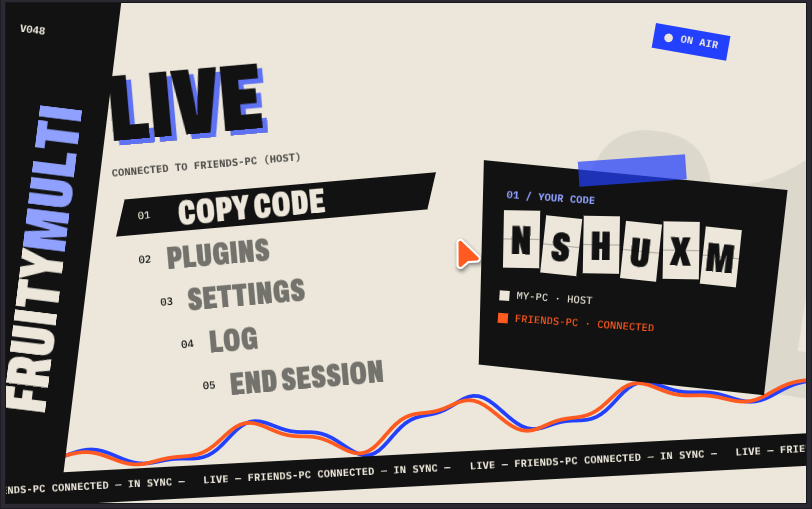
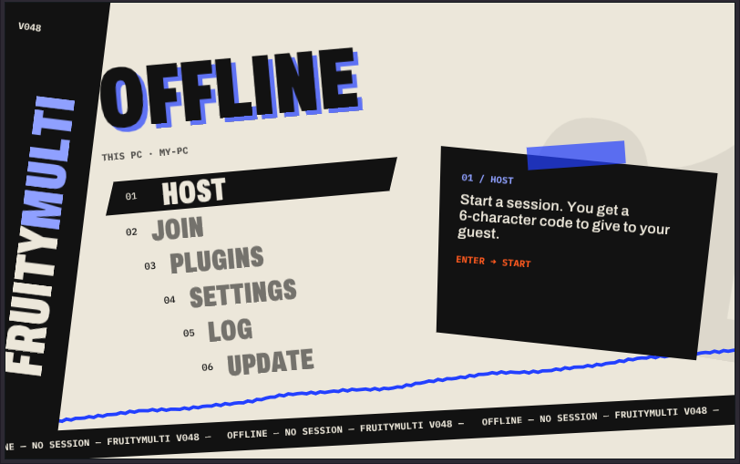
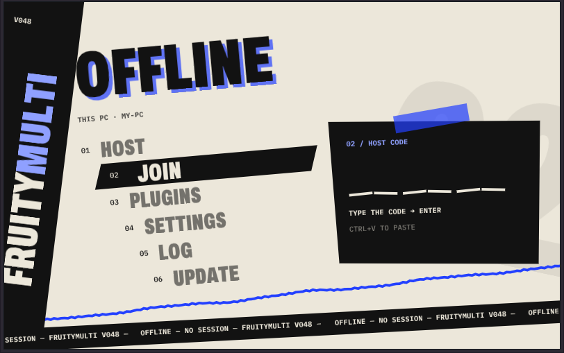

<div align="center">

# FruityMulti

**Make music together in FL Studio.**

Two PCs. One project. Everything you do appears on your friend's screen.

[](https://github.com/26mataa/FruityMulti/releases/latest/download/FruityMultiSetup.exe)

Free · Windows · FL Studio 26.1.7



</div>

## Get started

Both of you do this once:

1. **Download** [FruityMultiSetup.exe](https://github.com/26mataa/FruityMulti/releases/latest/download/FruityMultiSetup.exe) and run it.
2. If Windows says "Windows protected your PC", click **More info**, then **Run anyway**.
3. Open FL Studio and add **FruityMulti Bridge** to any mixer track.

Then start a session:

<table>
<tr>
<td width="50%"></td>
<td width="50%"></td>
</tr>
<tr>
<td><b>Person 1</b> clicks <b>HOST</b> and sends the 6-character code to their friend.</td>
<td><b>Person 2</b> clicks <b>JOIN</b>, pastes the code and presses Enter.</td>
</tr>
</table>

That's it. Person 2 gets Person 1's project, and you are making music together.

## What you share

| | |
|---|---|
| 🎹 **Notes** | Add or move a note and it moves on both PCs. |
| 🧩 **Playlist** | Clips and patterns. |
| ⏱️ **Tempo** | Always the same on both PCs. |
| ▶️ **Play and stop** | Separate by default, so you can each work. Turn sync on in **SETTINGS**. |
| 🎚️ **Mixer** | Volume, pan, mute, routing and effects. |
| 🎸 **Instruments** | Plugins, presets and every knob. |
| 🔊 **Samples** | The sound and all its Sampler settings. |
| 🖱️ **Cursor** | See where your friend is pointing and clicking. |

No sound goes through the internet. You each hear your own FL Studio, with no delay.

## Good to know

- You both need **FL Studio 26.1.7** on **Windows 64-bit**.
- A session is **two people**.
- You both need the same plugins. The **PLUGINS** page shows what is missing.
- Samples up to 64 MB are sent for you. Bigger samples and your own wavetables need to be on both PCs.
- You don't need to open any ports.
- To update, click **UPDATE** in the FruityMulti window.
- If FL Studio updates, FruityMulti turns itself off until a new version comes out.

FruityMulti is an independent project, not affiliated with Image-Line. FL Studio is a trademark of Image-Line.

<details>
<summary><b>For developers</b></summary>

FruityMulti has three parts:

- A **VST3 plugin** in C++ that runs inside FL Studio ([`dll/FruityMulti`](dll/FruityMulti)).
- An **agent** in Python that sends only what changed ([`net`](net)).
- A small **relay** on Cloudflare Workers that connects two PCs with a code ([`relais`](relais)).

The installer is in [`setup`](setup).

**Build the plugin.** You need Visual Studio 2022 and CMake. The VST3 SDK is not in this repository:

```powershell
git clone --recursive --depth 1 https://github.com/steinbergmedia/vst3sdk dll\vst3sdk
cmake -S dll\FruityMulti -B dll\build-fm -G "Visual Studio 17 2022" -A x64
cmake --build dll\build-fm --config Release --target FruityMultiBridge
```

**Build the agent.** You need Python 3.12:

```powershell
pip install -r requirements.txt pyinstaller
python -m PyInstaller --onefile --name fm_agent --distpath net\dist --workpath net\build --specpath net net\agent_sync.py
```

**Deploy the relay.** You need a free Cloudflare account:

```powershell
cd relais
npm install
npx wrangler login
npx wrangler deploy
```

Then put your relay address in `RELAIS` in `net/agent_sync.py`.

**Credits.** Interface made with [Dear ImGui](https://github.com/ocornut/imgui) (MIT). Fonts: [Archivo](https://github.com/Omnibus-Type/Archivo) and [IBM Plex Mono](https://github.com/IBM/plex) (OFL). Plugin built with Steinberg's [VST3 SDK](https://github.com/steinbergmedia/vst3sdk).

</details>
