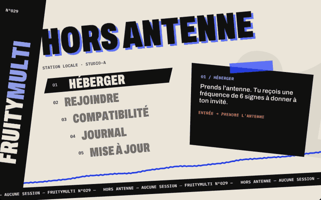
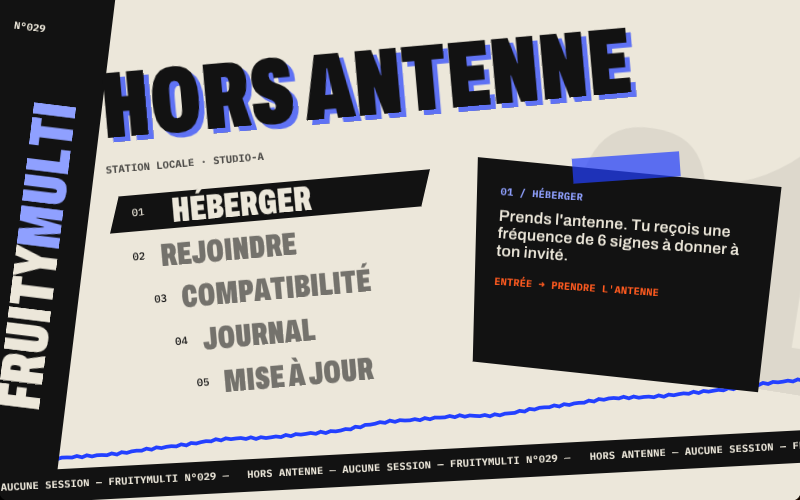
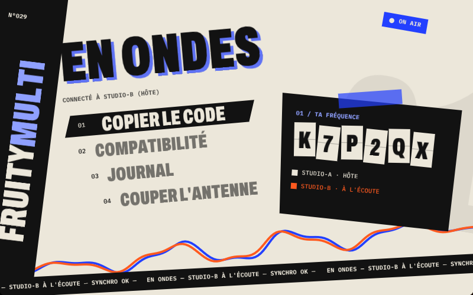
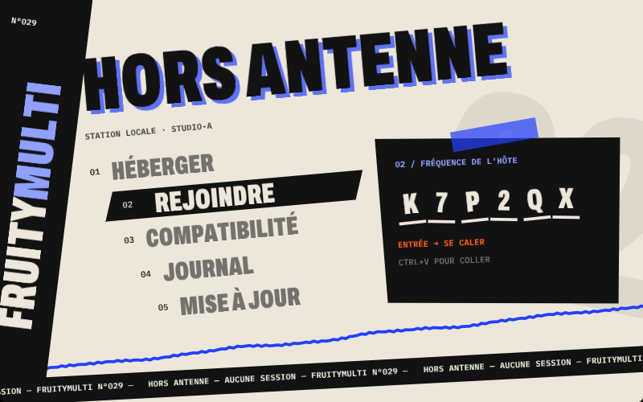
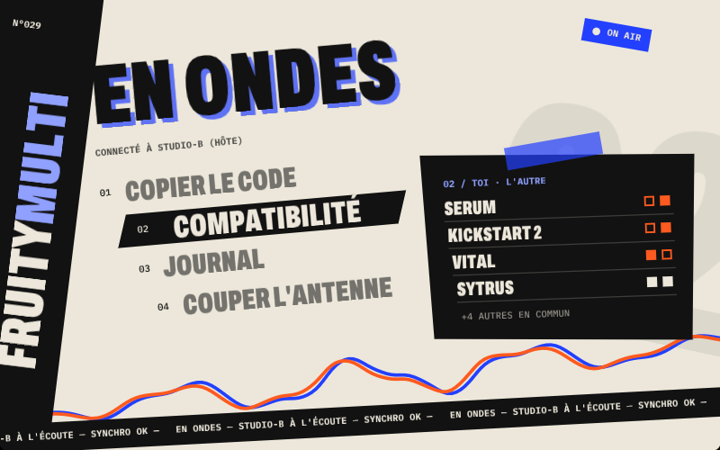
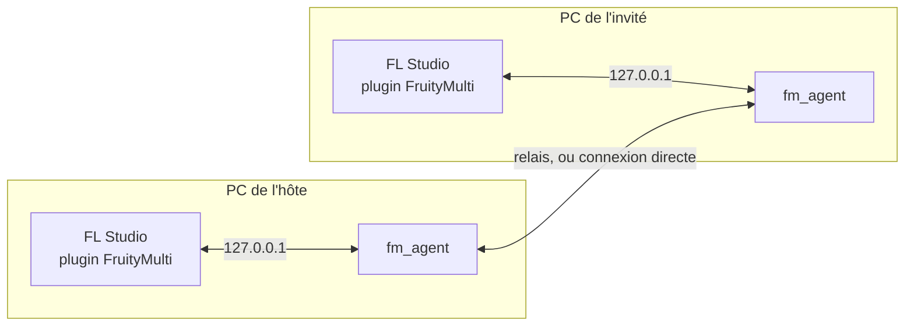

<div align="center">

# FruityMulti

**Le multijoueur pour FL Studio.**
Deux PC, un seul projet, chacun devant son FL.

[](https://github.com/26mataa/FruityMulti/releases/latest)




</div>

---

Tu poses une note, elle apparaît chez l'autre. Il change le tempo, le tien suit.
Pas de partage d'écran, pas de projet à s'envoyer par mail : FruityMulti relie
directement vos deux FL Studio pendant que vous composez.

Aucun son ne passe par le réseau. Chacun entend son propre FL, sans latence,
avec ses propres plugins.

## Ce qui se synchronise

| | |
|---|---|
| 🎹 **Notes** | sur le bon canal, même si vos racks ne sont pas dans le même ordre |
| 🧩 **Playlist** | clips et motifs |
| ⏱️ **Tempo et lecture** | tempo, motif courant, position de lecture |
| 🎚️ **Mixeur** | volumes, pans, mutes, master |
| 🎛️ **Effets** | réglages synchronisés quand le même effet est présent des deux côtés |

L'hôte a le dernier mot sur le projet (tempo, motif, transport). Pour le reste,
vous travaillez à égalité : les notes et le mixeur appartiennent aux deux.

## Installer

1. Ferme FL Studio.
2. Télécharge **[FruityMultiSetup.exe](https://github.com/26mataa/FruityMulti/releases/latest/download/FruityMultiSetup.exe)** et lance-le.
3. Windows peut afficher « Windows a protégé votre ordinateur », car
   l'installateur n'est pas signé : clique sur **Informations complémentaires**,
   puis **Exécuter quand même**.
4. Ouvre FL Studio et ajoute l'effet **FruityMulti Bridge** sur une piste du
   mixeur, puis ouvre sa fenêtre.

Les deux PC ont besoin de la même chose : **FL Studio 26.1.7**, et les mêmes
instruments pour entendre le même morceau.

## Jouer à deux

<table>
<tr>
<td width="50%"></td>
<td width="50%"></td>
</tr>
<tr>
<td><b>Celui qui héberge</b> clique sur <b>HÉBERGER</b> et reçoit une fréquence de 6 signes.</td>
<td>Il la donne à l'autre. Dès que l'invité arrive, l'onde orange rejoint la bleue.</td>
</tr>
<tr>
<td width="50%"></td>
<td width="50%"></td>
</tr>
<tr>
<td><b>Celui qui rejoint</b> clique sur <b>REJOINDRE</b>, tape le code ou le colle avec Ctrl+V, puis valide avec Entrée.</td>
<td><b>COMPATIBILITÉ</b> montre les plugins que l'un a et pas l'autre, avant que ça sonne faux.</td>
</tr>
</table>

La fenêtre se pilote aussi au clavier : flèches pour se déplacer, Entrée pour
valider.

> [!NOTE]
> **Connexion.** Aucun port à ouvrir : le code passe par un relais. Si le relais
> est injoignable, l'hôte bascule en connexion directe et reçoit une adresse de la
> forme `82.64.12.7:5000/K7P2QX`, à coller telle quelle chez l'invité. Ce repli
> demande une box compatible UPnP ou le port 5000 ouvert.

## Mises à jour

**MISE À JOUR** dans la fenêtre interroge GitHub. Si une version plus récente
existe, Entrée la télécharge et l'installe : FL se ferme, le plugin est remplacé,
FL redémarre.

## Limites

- Windows 64 bits uniquement.
- Deux personnes par session.
- Une seule version de FL est prise en charge. Si FL est mis à jour, le plugin
  se désactive par sécurité et la fenêtre le signale, en attendant une version
  de FruityMulti adaptée.
- Les fichiers audio et les presets ne sont pas transférés.

## Comment ça marche



Le **plugin VST3** (C++) vit dans FL : il lit et écrit dans le moteur et dessine
la fenêtre. L'**agent** (Python) compare l'état du projet avec celui de l'autre
PC et n'envoie que les différences, regroupées toutes les 40 ms.

Le **relais** est un petit service sur l'offre gratuite de Cloudflare Workers :
un salon par code, qui recopie les messages d'un PC à l'autre. Si l'autre ne
donne plus de nouvelles pendant 20 s, la session est considérée comme perdue et
se rouvre toute seule.

| Dossier | Contenu |
|---|---|
| [`dll/FruityMulti`](dll/FruityMulti) | le plugin et sa fenêtre |
| [`net`](net) | l'agent de synchronisation |
| [`relais`](relais) | le relais Cloudflare |
| [`setup`](setup) | l'installateur |

<details>
<summary><b>Compiler depuis les sources</b></summary>

Il faut Visual Studio 2022, CMake et Python 3.12.

**Plugin.** Le SDK VST3 n'est pas inclus dans le dépôt :

```powershell
git clone --recursive --depth 1 https://github.com/steinbergmedia/vst3sdk dll\vst3sdk
cmake -S dll\FruityMulti -B dll\build-fm -G "Visual Studio 17 2022" -A x64
cmake --build dll\build-fm --config Release --target FruityMultiBridge
```

**Agent.**

```powershell
pip install -r requirements.txt pyinstaller
python -m PyInstaller --onefile --name fm_agent --distpath net\dist --workpath net\build --specpath net net\agent_sync.py
```

**Relais** (compte Cloudflare gratuit, sans carte bancaire) :

```powershell
cd relais
npm install
npx wrangler login
npx wrangler deploy
```

Reporte ensuite l'adresse obtenue dans `RELAIS`, en tête de la partie réseau de
`net/agent_sync.py`.

</details>

## Crédits

Interface dessinée avec [Dear ImGui](https://github.com/ocornut/imgui) (licence MIT),
polices [Archivo](https://github.com/Omnibus-Type/Archivo) et
[IBM Plex Mono](https://github.com/IBM/plex) (licence OFL), plugin construit avec le
[SDK VST3](https://github.com/steinbergmedia/vst3sdk) de Steinberg.

FruityMulti est un projet indépendant, sans lien avec Image-Line.
FL Studio est une marque d'Image-Line.
