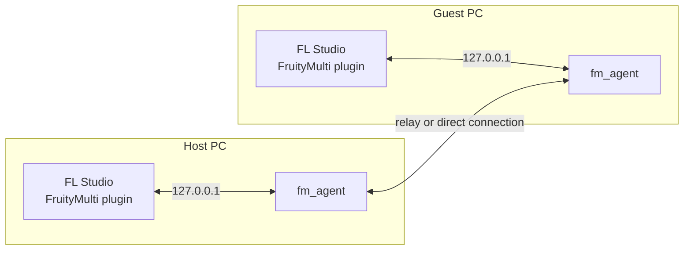

<div align="center">

# FruityMulti

**Multiplayer for FL Studio.**
Two PCs, one project, each person in their own FL.

[](https://github.com/26mataa/FruityMulti/releases/latest)


</div>

---

Add a note and it shows up on the other PC. Change the tempo and theirs follows.
No screen sharing, no emailing project files: FruityMulti links your two FL
Studios while you make music.

No audio goes over the network. Each person hears their own FL, with no delay.

## What stays in sync

| | |
|---|---|
| 🎹 **Notes** | on the right channel, even if your racks are in a different order |
| 🧩 **Playlist** | clips and patterns |
| ⏱️ **Tempo and playback** | tempo, current pattern, play position |
| 🎚️ **Mixer** | volume, pan, mute, routing, master |
| 🎛️ **Effects** | added effects and all their settings |
| 🎸 **Instruments** | added instruments, their settings, presets and wavetables, including heavy plugins |
| 🔊 **Sampler** | the sample itself and the channel's settings |
| 🖱️ **Cursor** | your friend's cursor and clicks, on the same window as them |

You both start from the host's project. After that you work as equals, and the
host has the final say on tempo, pattern and transport.

## Install

1. Close FL Studio.
2. Download **[FruityMultiSetup.exe](https://github.com/26mataa/FruityMulti/releases/latest/download/FruityMultiSetup.exe)** and run it.
3. Windows may say "Windows protected your PC" because the installer is not
   signed. Click **More info**, then **Run anyway**.
4. Open FL Studio, add the **FruityMulti Bridge** effect to a mixer track, and
   open its window.

Both PCs need **FL Studio 26.1.7**. If a plugin is on only one PC, the other
person gets an empty channel with its name, and the **PLUGINS** page shows
what is missing.

## Play together

1. The first person clicks **HOST** and gets a 6-character code.
2. They send the code to the other person.
3. The other person clicks **JOIN**, types or pastes the code, and presses Enter.
4. The guest loads the host's project. You are now live.

You can also use the window with the keyboard: arrows to move, Enter to confirm.

> [!NOTE]
> **Connection.** You don't need to open any ports: the code goes through a
> relay. If the relay can't be reached, the host switches to a direct connection
> and gets an address like `82.64.12.7:5000/K7P2QX`. Paste it as it is on the
> guest's PC. This needs a router with UPnP, or port 5000 open.

## Updates

Click **UPDATE** in the window. If there is a newer version, press Enter: FL
closes, the plugin is replaced, and FL restarts.

## Limits

- Windows 64-bit only.
- Two people per session.
- One FL version is supported. If FL updates, the plugin turns itself off and
  says so in its window until a new FruityMulti comes out.
- Very large samples and plugin states are not sent.
- Your own wavetable files are not sent: a table you imported needs to be on
  both PCs. Tables that come with the plugin work everywhere.

## How it works



The **VST3 plugin** (C++) runs inside FL. It reads and writes the project and
draws the window. The **agent** (Python) compares your project with the other PC
and sends only what changed.

The **relay** is a small service on Cloudflare Workers' free plan: one room per
code, passing messages between the two PCs.

| Folder | Contents |
|---|---|
| [`dll/FruityMulti`](dll/FruityMulti) | the plugin and its window |
| [`net`](net) | the sync agent |
| [`relais`](relais) | the Cloudflare relay |
| [`setup`](setup) | the installer |

<details>
<summary><b>Build from source</b></summary>

You need Visual Studio 2022, CMake and Python 3.12.

**Plugin.** The VST3 SDK is not in this repository:

```powershell
git clone --recursive --depth 1 https://github.com/steinbergmedia/vst3sdk dll\vst3sdk
cmake -S dll\FruityMulti -B dll\build-fm -G "Visual Studio 17 2022" -A x64
cmake --build dll\build-fm --config Release --target FruityMultiBridge
```

**Agent.**

```powershell
pip install -r requirements.txt pyinstaller
python -m PyInstaller --onefile --name fm_agent --distpath net\dist --workpath net\build --specpath net net\agent_sync.py
```

**Relay** (free Cloudflare account, no card needed):

```powershell
cd relais
npm install
npx wrangler login
npx wrangler deploy
```

Then put the address you get in `RELAIS`, at the start of the network section of
`net/agent_sync.py`.

</details>

## Credits

Interface drawn with [Dear ImGui](https://github.com/ocornut/imgui) (MIT license),
fonts [Archivo](https://github.com/Omnibus-Type/Archivo) and
[IBM Plex Mono](https://github.com/IBM/plex) (OFL license), plugin built with
Steinberg's [VST3 SDK](https://github.com/steinbergmedia/vst3sdk).

FruityMulti is an independent project, not affiliated with Image-Line.
FL Studio is a trademark of Image-Line.
